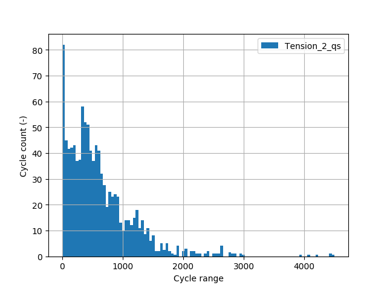
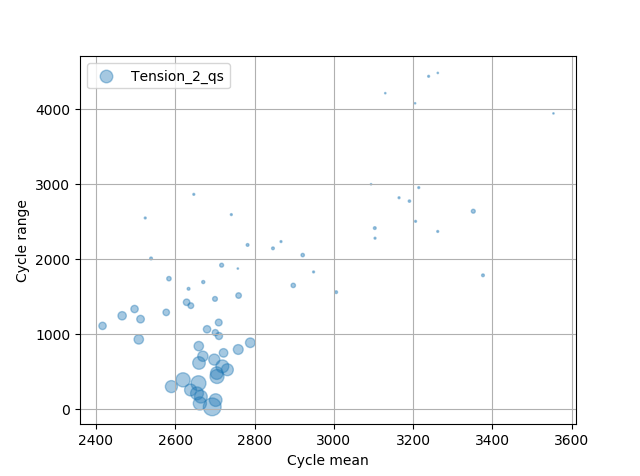
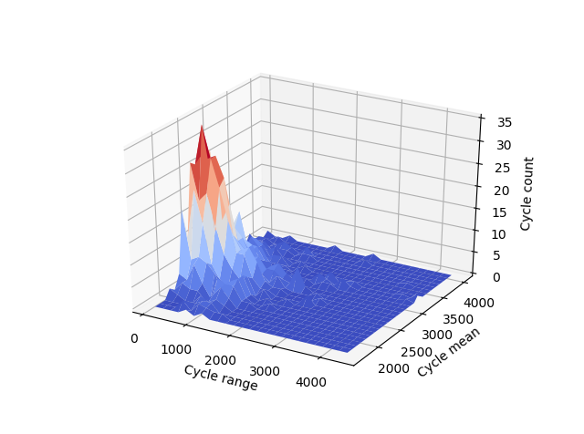
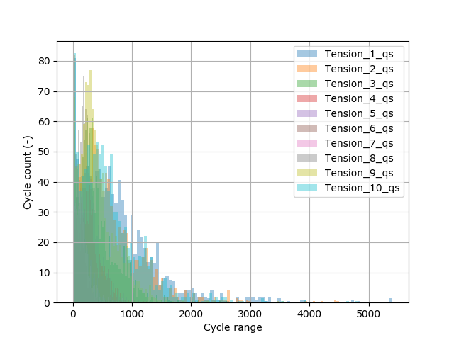
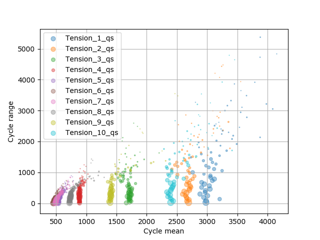
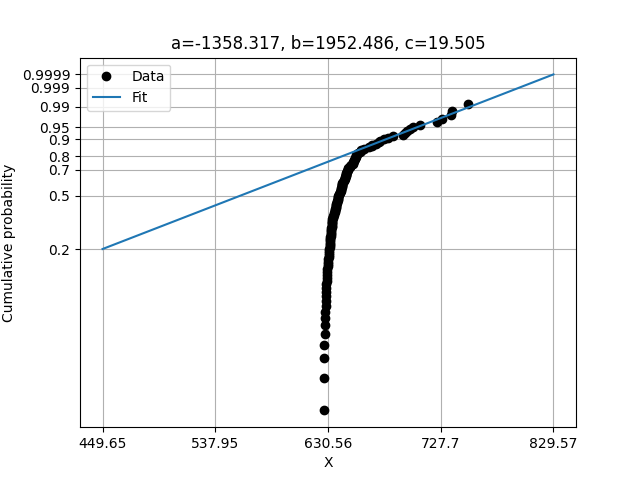

.. _examples:

Code examples
#############

.. note:: More examples will be provided on request.

Plot time series and power spectral density
*******************************************

Import the time series database, load data from file and plot all time series.

.. literalinclude:: examples/plot.py
   :language: python
   :linenos:
   :lines: 1-16

You can also select a subset of the timeseries (suports wildcards) as shown below.

.. literalinclude:: examples/plot.py
   :language: python
   :linenos:
   :lineno-start: 15
   :lines: 18-19

You can also plot the power spectral density of the selected time series. Because the 'surge' time series was sampled at
a varying time step the the time series are resampled to a constant time step of 0.1 seconds before the FFT.

.. literalinclude:: examples/plot.py
   :language: python
   :linenos:
   :lineno-start: 15
   :lines: 21-22

Count cycles using the Rainflow algorithm
*****************************************

.. note::
    Some of the syntax shown below is not applicable for ``version <= 4.6.1``, in particular the unpacking of cycles.
    The changes implemented since 4.6.1 are backwards compatible, however; the syntax suggested below is recommended due
    to better performance. One may also experience minor changes in rebinned cycles. Finally, the mesh established by
    :func:`qats.fatigue.rainflow.mesh()` (and used by :meth:`TimeSeries.plot_cycle_rangemean3d`) was not correct for
    version <= 4.6.1. For more details, please refer to the
    `release notes of 4.7.0 <https://github.com/dnvgl/qats/releases/tag/4.7.0>`_.

Fetch a single time series from the time series database, extract and visualize the cycle distribution using the
Rainflow algorithm.

.. literalinclude:: examples/rainflow.py
   :language: python
   :linenos:
   :lines: 1-29

    Single cycle range distribution.

    Single cycle range-mean distribution.

    Single 3D cycle range-mean distribution

Compare the cycle range and range-mean distribution from several time series using the methods on the TsDB class.

.. literalinclude:: examples/rainflow.py
   :language: python
   :linenos:
   :lineno-start: 30
   :lines: 30-34

    Comparison of several cycle range distributions.

    Comparison of several cycle range-mean distributions.

Calculate fatigue damage in mooring lines
*****************************************

Using a traditional S-N curve with constant slope and intercept.

.. literalinclude:: examples/mooring_fatigue.py
   :language: python
   :linenos:
   :lines: 1-

Apply low-pass and high-pass filters to time series
***************************************************

Initiate time series database and load time series file in one go. Plot the low-passed and high-passed time series and
the sum of those.

.. literalinclude:: examples/timeseries_filter.py
   :language: python
   :linenos:
   :lines: 1-

Tail fitting with Weibull
*************************

Fit a parametric Weibull distribution to the largest 13% of the peak sample. Often called tail fitting.

.. literalinclude:: examples/tail_fitting.py
   :language: python
   :linenos:
   :lines: 1-

    Comparison of empirical sample distribution and fitted parametric distribution on linearized scales.

Units from MATLAB files
***********************

Files in the SINTEF Ocean test data exchange format store a unit for each channel, which QATS reads into
``TimeSeries.unit``.

.. literalinclude:: examples/mat_units.py
   :language: python
   :linenos:
   :lines: 1-

Read OpenFAST results
*********************

QATS reads OpenFAST text (``.out``) and binary (``.outb``) output files, also those written by the module drivers, with
the channel units. Binary files usually store each channel as 16-bit integers scaled to the channel's range, so their
values are accurate to about 1/65535 of that range.

.. literalinclude:: examples/openfast.py
   :language: python
   :linenos:
   :lines: 1-

Post-process OrcaFlex results
*****************************

OrcaFlex results are read through Orcina's Python interface, ``OrcFxAPI``, which computes each result on request: for
an object, a variable and, for lines, a point along the line. A short script extracts the time histories you need
into a ``TsDB``; from there, statistics, extremes and fatigue work as for any other file, and the series can be
exported to a file the QATS GUI opens. The same pattern works for any simulation tool with a Python interface.

.. note::

   This example requires OrcaFlex with a licence and the ``OrcFxAPI`` package, so it is not run when the
   documentation is built. It was written for OrcaFlex 11.6.

.. literalinclude:: examples/orcaflex.py
   :language: python
   :linenos:
   :lines: 1-

Read Bladed results
*******************

Bladed writes each output group as a header file (``.%NN``) and a data file (``.$NN``); open the header. Units are
given in SI. Groups with a second axis, such as stations along a blade, give one series per variable and station.

.. literalinclude:: examples/bladed.py
   :language: python
   :linenos:
   :lines: 1-

Choose a file reader and add your own
*************************************

List the available file readers, choose a reader for a file whose name does not tell its format, and add a reader for
a file format of your own in a script. To make a reader available in every script and in the GUI, put it in a package
that registers it through the ``qats.readers`` entry point group (see :ref:`reader_plugins`).

.. literalinclude:: examples/reader_registry.py
   :language: python
   :linenos:
   :lines: 1-

Merge files and export to different format
******************************************

.. todo:: Coming soon
