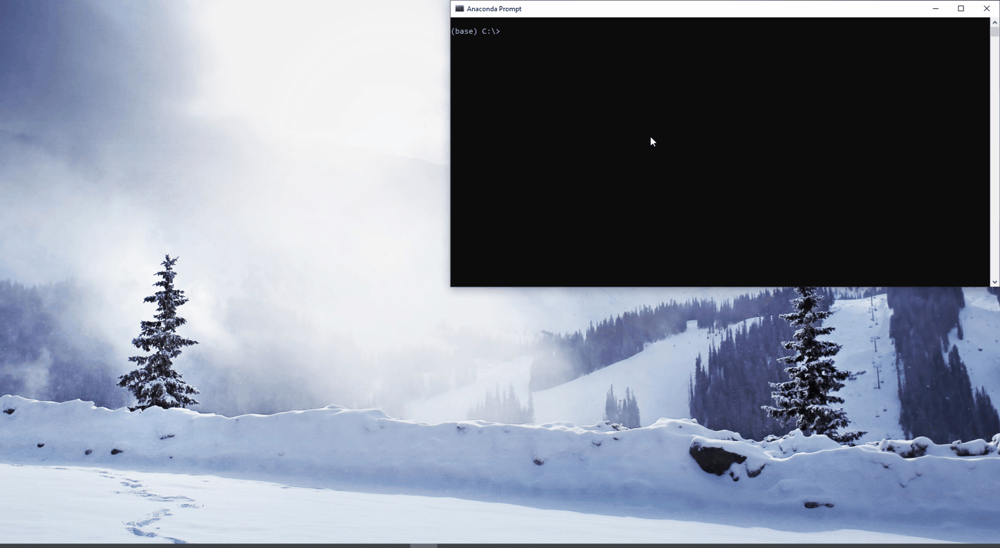
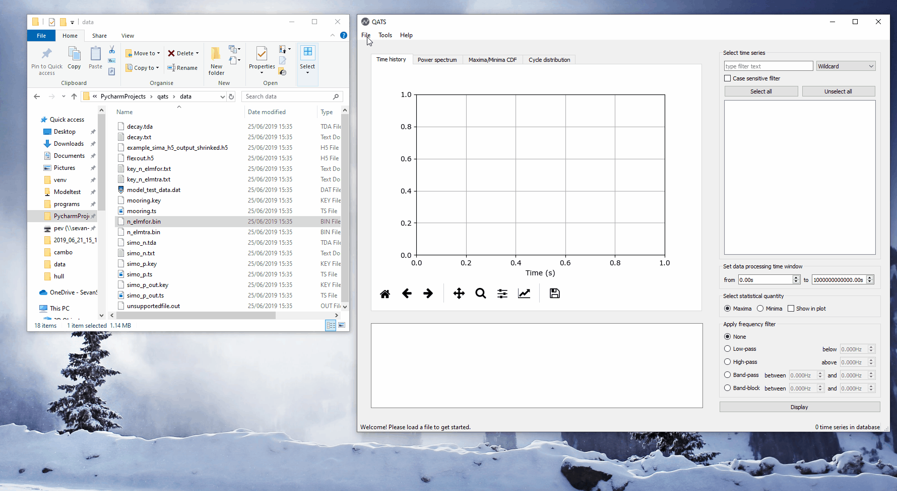

.. _gui:

Graphical User Interface
########################

.. todo:: Make more examples demonstrating typical operations.

Create link to GUI in start menu and desktop
********************************************

    In the terminal, run :code:`qats config --link-app` to create start menu and desktop links to qats. Pin the start menu
    link to the taskbar to further ease accessibility.

Import time series from file
****************************

    Here 41 time series from two files (different format) are imported. The first file is imported using the file open
    dialogue (hotkey *CTRL+I*) and the second by drag-and-drop. Finally the time series database is cleared (hotkey *Ctrl+Del*).

The file open dialogue lists every file format QATS can read, including formats added by installed reader plugins
(see :ref:`examples`). Files that no reader can read, whether opened or dropped, are reported in the log window; the
other files are imported.

Maxima/minima distribution
**************************

The *Statistics* and *Maxima/minima CDF* tabs use the same Weibull fit to the maxima (or minima) of each time series,
set in *Settings* under "Maxima/minima distribution":

- **Weibull fit method**: pwm, msm, lse or mle.
- **Tail**: fit only the largest maxima (lowest minima), as a fraction of all of them.
- **Tail model**: a censored fit to all maxima, where the smaller maxima count only by their number, or a fit to the
  exceedances of the threshold value u, the maxima above u as a sample of their own. See
  :meth:`~qats.stats.weibull.Weibull.fit`.
- **Location parameter**: fitted, at the mean level, at a value, or at u in a fit to the exceedances.
- **Plotting positions** of the maxima on Rayleigh paper. An lse fit is fitted to them. The *Extremes CDF* tab has a
  setting of its own.
- **Fit to the exceedances drawn**: how the *Maxima/minima CDF* tab draws a fit to the exceedances.

  - *exceedances* (default): as fitted, with only the maxima above u of each series at their own plotting positions,
    and the fitted distribution F_u, conditional on exceeding u. The probability axis is then
    Pr{X <= x | X > u}, and each series has its own u.
  - *full-sample*: all maxima, and the fitted distribution solved for all maxima, F = 1 - p (1 - F_u), where p is the
    fraction of the maxima above u. The maxima outside the fit are faded. This view can be compared with a censored
    fit.

  See :func:`~qats.stats.paper.probability_paper` for both views.

For example, to see how well a fit to the exceedances describes the largest maxima of two mooring lines, check
"Fit only the largest maxima" with 0.20, choose the tail model *exceedances* and display the two series: the
*Maxima/minima CDF* tab shows the maxima above each line's u against its fitted distribution. Choose *full-sample* to
see the same fits with all maxima instead.

Extremes distribution
*********************

*Tools > Plot extremes CDF* fits a Gumbel distribution to the extremes of the selected time series, one from each: the
largest maximum, or the smallest minimum when *Minima* is selected under "Select statistical quantity". The time window
and the filter apply. The series should be realisations of one process, for example simulations of the same sea state
with different seeds, so select at least two. The extremes and the fitted distribution are drawn on Gumbel paper in a
new tab, whose title names the fit. Minima are fitted multiplied by -1 and drawn in their own units.

The fit is set in *Settings* under "Extremes distribution (extremes CDF)":

- **Gumbel fit method**: pwm (default), msm, lse or mle, see :meth:`~qats.stats.gumbel.Gumbel.fit`. With the few
  extremes of a set of simulations, the methods can give quite different upper quantiles.
- **Plotting positions** of the extremes on Gumbel paper, independent of the plotting positions of the maxima/minima
  distribution. Median ranks are the default; Gringorten is the usual nearly unbiased choice for a Gumbel
  distribution. An lse fit is fitted to them; the other methods don't use them.

Changed settings apply to the next *Extremes CDF* tab; tabs already open keep the fit they show. If the distribution
can't be fitted, for example to equal extremes, the extremes are drawn without a line and the log window says so.
The example :ref:`gumbel_realisations` makes the same fits and plot with the library.
